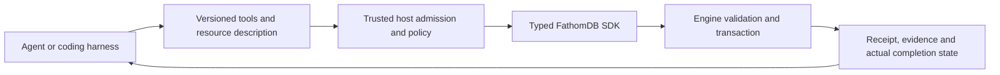

# Composable agent data interfaces for FathomDB

Placed in the [0.9.0 backlog](../../plans/0.9.0/backlog.md) by owner seq-404.
The research is an input to future planning; it adds no 0.8.30 implementation.

FathomDB can give agents tested data behaviors to compose and a semantic
interface for operating them. The opportunity is to make identity, provenance,
retrieval, dependencies and committed outcomes easy to discover and use
correctly. An agent should describe an application operation and receive its
actual data-plane outcome without reconstructing storage semantics from tables,
logs or guessed reference strings.

This is a proposal informed by the [UI SDK review](01-vercel-ui-sdk-review.md)
and [agent/harness reflection](02-agent-harness-mechanisms.md), reviewed against
FathomDB's current contracts. It does not allocate release work or authorize
implementation. UI SDK source was pinned to
`3647512865fe0242b749dd8981c51c75ad5f486b`; FathomDB's integrated release baseline
was `5f4edd9831ddbb5ee12ebe594a3f6cd17fcc46b8`. Slice30's implementation branch
is still undergoing verification. Candidate fixes are not published features.

## The mechanism to transfer

UI SDK connects reusable behavior, one component definition, framework
adapters, tests and agent operation. Its semantic bridge reduces the agent's
need to reconstruct the interface. Its shipped documentation helps a coding
agent use the version actually installed. Those are two related product
surfaces: **agents build an application; agents then operate that application**.

For data, an application could compose a supported-claim behavior from a
canonical source, a derived record, its direct dependency, an eligibility
context and one atomic mutation. A coding agent wires that composition using
the typed SDK. A runtime agent sees only the application-approved reads and
actions, with source evidence and honest outcomes. The same engine contracts
must govern both routes.

The analogy stops at persistence. UI SDK action steps are sequential and can
leave partial effects; UI value history cannot undo saving or network work.
FathomDB must retain its stronger transaction, concurrency, replay and erasure
contracts. Copy the reduction in translation, not UI execution semantics.

## What FathomDB already has

| Foundation | Current contract | Consequence for this proposal |
| --- | --- | --- |
| Shared application SDKs | Rust, Python and TypeScript expose governed operations with checked parity | Build adapters over these operations, not a second storage implementation. |
| Agent read interface | MCP has seven tools, bounded output, snippets, hints, typed errors and continuations | Improve this established agent experience; do not claim an agent interface is missing. |
| Exact reads | Frozen contexts reproduce or refuse; evidence binds disclosure to exact revisions | Separate current logical lookup from exact historical evidence. |
| Atomic mutation | Actuation accepts five operation kinds in a bounded 1–128-operation transaction | Compose source, derived artifacts and dependencies in a real transaction. |
| Retry and concurrency | Operation-ID/digest replay, optional expected-write boundary, revision-pinned lifecycle changes | Use engine-enforced preconditions and replay, not host-side read-then-write checks. |
| Lifecycle | Registered dependencies propagate source changes and erasure; incomplete closure fences eligibility | Report actual closure and projection state rather than a generic success flag. |

These are grounded in the [SDK interface](../../interfaces/rust-sdk.md),
[MCP interface](../../interfaces/mcp.md),
[engine contracts](../../interfaces/rust.md), and
[data-plane architecture](../../design/fathomdb-data-plane-architecture-v2.md).
The [actuation implementation](../../../src/rust/crates/fathomdb-engine/src/actuation.rs)
includes `expected_write_boundary` and revision-pinned lifecycle operations.
An individual record cursor must not be substituted for a compatible global
write boundary.

There are important gaps. Current MCP is explicitly read-only and unscoped;
`remember`, `replace` and `retract` tools are absent by contract. Its `expand`
uses a current context, while the SDK supports frozen explicit expansion.
The SDK's frozen/evidence operations are not exposed as that same exact workflow
by the current MCP toolset; logical `fetch` is not exact evidence resolution.
`orient` explicitly cannot supply some state, kind and count capabilities.
The SDK also does not yet present a unified package-local agent-docs and
composition workflow comparable to UI SDK. These gaps need distinct treatment.

## A product shape with two interfaces

### 1. Build-time data behaviors

Start with documented composition recipes, typed builders and contract tests
around existing operations. Avoid introducing a generic data DSL or rewriting
the engine to imitate `definePrimitive` literally.

| Data behavior | Engine mechanisms to reuse | App-owned decisions |
| --- | --- | --- |
| Canonical source | Versioned source provenance, caller identity, canonical hashing | What the source is and who may admit it |
| Supported assertion | Complete derived provenance plus one direct source dependency | Extraction, ontology and whether the assertion is warranted |
| Evidence-backed retrieval | Eligibility, bounded search, frozen context, evidence resolution | Query planning and answer synthesis |
| Bounded relationship expansion | Explicit logical-node seeds, direction, relation filters, origin | Which graph vocabulary and traversal serve the task |
| Revision-aware change | Typed actuation, preconditions and operation replay | Whether a mutation should happen and its authorization |

One recipe should demonstrate creating a source, derived assertion and
dependency atomically, then retrieving and resolving its evidence. Another
should demonstrate relevance-selected frozen retrieval followed by constrained
graph expansion. Recipes should include refusal cases, not only happy paths.
They must preserve the current single-canonical-source dependency profile.

Ship a small index, focused examples, errors and recipe tests with each SDK
package. A package-local skill should direct a coding agent to the installed
index and relevant pages, then to the contract tests. Give unsupported harnesses
the same instructions as ordinary Markdown. Do not depend on a particular model,
network documentation lookup or automatic changes to a consumer's AGENTS.md.

Generate or validate documentation and schemas from existing authoritative
types and the governed operation inventory. The inventory describes membership,
not every request schema; filling that gap must not create a second unchecked
contract registry. Test the installed wheel, npm package and Rust crate, rather
than assuming repository docs were included in their distributions.

### 2. Runtime resource affordances

Expose a host-declared data resource with its available operations, bounds,
reference kinds, evidence support and exact outcome semantics. Initially this
can be a typed host adapter and small manifest over the SDK. The model must not
invent raw SQL, file paths, source authority or arbitrary engine methods.

An illustrative declaration, **not an existing FathomDB API**, is:

```json
{
  "resource": "project-memory",
  "profile": "evidence-reader",
  "reads": ["frozen-search", "resolve-evidence", "bounded-expand"],
  "mutations": [],
  "bounds": { "results": 20, "response_tokens": 2048 },
  "identity": "engine-and-host-issued-references"
}
```

The names above describe an application profile, not new engine verbs. Bind
them to existing typed requests. Advertise only supported capabilities, with an
explicit unavailable reason. Discovery is advisory: every call must recheck
authorization and state at execution. A listed action is not a permission grant.

Use readable labels for discovery while retaining unambiguous exact references
for execution. Logical identity, immutable artifact revision, response
occurrence and frozen evidence authority are different things. Do not turn a
short response handle into a permanent key or silently resolve an ambiguous
entity name. This matters directly to the
[extractor investigation](../ingest-with-extractor-memory-graph-proposal.md)
and Slice30's revision-scoped feedback correction.

## One execution path, explicit ownership



FathomDB owns durable facts and mechanisms. The host owns credentials,
authorization, model choice, approval UX and semantic decisions. The harness
owns tool dispatch, context assembly and cancellation handling. Retrieved text
is data; tool descriptions should say so, and host policy must remain outside
that text. A field saying `agent` or `owner` is not an authenticated principal.

Start runtime experiments with a dedicated store and an explicit read-only host
profile. Existing search attributes are eligibility predicates, not universal
tenant isolation. Do not claim that a scoped search prevents disclosure through
every point-read or graph route. The existing
[origin/scope proposal](../../design/mcp-adapter/engine-proposals/EP-10-write-trust-origin-and-scope.md)
already identifies this concern and remains a proposal. General multitenant
write exposure requires an accepted all-path authority contract.

For a separately admitted mutation profile, the host binds an approved typed
request, supplies its operation identity and selects actual engine
preconditions. The engine validates and commits once; a refusal rejects the
whole batch. A human preview should display the proposed request and effects
the application actually knows. It must not apply writes and call an attempted
undo a preview. No generic validation-only preview API is assumed here.

After a lost response, retry only the same operation identity and payload when
appropriate; changed payload is a new decision. Read actual receipts and
projection/closure state. Transaction commit is not a promise that every
projection has caught up or physical erasure has finished. Cancelling a chat
does not prove a started mutation rolled back. Frozen read drift calls for a
fresh read/decision cycle, not replaying stale authority against newer state.

## Transport and harness integration

Use the same typed tool definitions and result semantics for a direct host
tool adapter and an MCP transport. Keep framework or model SDK integrations
thin. MCP is a transport boundary, not the source of database authorization.
UI SDK's WebMCP registration is browser-specific; it does not justify a browser
dependency in an embedded data plane.

Changing FathomDB's fixed MCP tool inventory, write policy or scope is a public
contract change. Prototype mutation recipes through an explicitly controlled
SDK host first; do not quietly enable the currently forbidden MCP `write` flag.
Any accepted extension needs an ADR/interface update and cross-SDK parity.
There is no reason to preserve obsolete pre-1.0 contract variants as shims.

For observations, begin with bounded receipts, explicit re-reads and existing
closure/status operations. A universal change subscription, durable event
history or resumable snapshot lease is new scope. UI SDK's `subscribe` is a
useful interaction pattern, not evidence those storage mechanisms already exist.
Likewise, do not promise generic undo of persisted writes or erased data.

## A bounded first experiment

1. **Version-matched builder experience.** Package the index, two composition
   recipes, a small skill and focused real-store tests. Confirm each published
   artifact contains the matching docs. Demonstrate a coding agent can build a
   supported assertion flow using only its installed package and task context.
2. **Read-and-evidence operating loop.** Demonstrate discovery, bounded search,
   exact resolution and constrained expansion on one dedicated data resource
   through a typed SDK host. Use current MCP for its supported read workflow;
   exposing the exact SDK loop through MCP requires an approved tool-contract
   extension. No new ranking algorithm, namespace or provenance model is needed.
3. **One controlled mutation workflow.** After authority/design review, admit
   the existing atomic supported-assertion recipe through a trusted SDK host.
   Exercise refusal, replay, stale precondition, reopen and source lifecycle.
   Leave broad MCP writes and arbitrary application mutation out of the pilot.

The pilot should not include a new storage backend, universal schema language,
automatic entity resolution, multi-source liveness, general mutation tool,
persisted snapshot leases or a model framework embedded in the engine. Existing
correctness fixes, including
[issue264](../dependency-trace-partial-span-issue-264.md), remain necessary
foundations rather than substitutes for this evaluation.

## Acceptance and measurement

Use deterministic real-store tests before paying for agent trials. A recipe
must create exactly the expected revisions and dependency, refuse malformed
or unauthorized input without partial effects, replay an identical request
without duplicate writes, and reject changed-payload reuse. Resolve the correct
source bytes after reopen; stale, erased and cross-resource references must not
disclose data. Check whole-source integrity independently of cited span bounds.

Test the complete loop across supported SDKs and the selected tool transport:
unknown arguments, unavailable capabilities, truncation, no-result versus
not-ready, reference ambiguity, budget limits, frozen drift, projection lag,
source deletion and lost-response recovery. Output truncation must never become
a claim of complete search or fully inspected evidence. Property tests should
target identity, source binding and retry/state sequences, following the
[quality roadmap](../fathomdb-quality-testing-roadmap.md).

Then run a small, explicitly budgeted agent study with fixed stores, tasks,
model, harness, ranking settings and authority. Compare the current SDK/MCP
experience with documentation improvements separately from runtime tool
improvements. Give both sides equivalent capabilities; a new mutation tool
cannot fairly be compared with a read-only baseline. Include source correction,
exact-token lookup, evidence resolution, constrained expansion, stale-state
refusal and response-loss recovery, not only easy successful reads.

Measure verified task success, incorrect/stale disclosures, unauthorized or
duplicate writes, tokens and calls per correct completion, end-to-end latency,
recovery effort and coding-agent test success. Count read/cache tokens
consistently and preserve failures. Report distributions and exact subjects;
UI SDK's small settings-task result is a hypothesis for FathomDB, not a target
to copy or a promised saving.

## Recommendation

Begin with the package-local builder experience and one read/evidence loop.
Add the controlled atomic recipe only after its authority boundary is proved.
This advances an agent data interface by reusing FathomDB's strongest existing
mechanisms and making their correct composition easy. Product success means
agents reliably finish real data tasks with less reconstruction and fewer
repairs, while the engine still enforces durable correctness.
