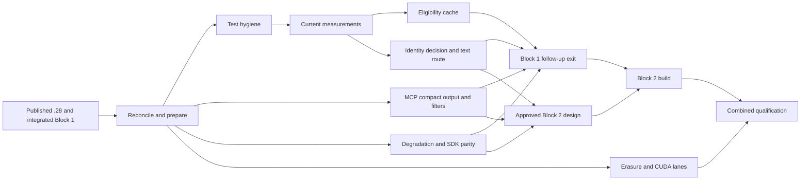

# 0.8.29 reconciliation and integration plan

## Purpose and authority

Reconcile the paused MCP, agent-access, queue, search-scale and CUDA work into
`dev/0.8.29`. The [release plan](../plan-0.8.29.md) remains the numbered ladder
of record. This supplement identifies existing integration, maturity, dependencies
and bounded promotions. The expanded release/slice proposal supersedes this
register's original allocation where noted; Slice 9 reviews the refinements;
publication and experimental defaults are not authorized by this plan.

## Verified starting point

- Audited November 9. `dev/0.8.29` is
  `6edc1155f039f87cd0a37660cb27ae4373bbce71`.
- Fetched `origin/dev/0.8.28`, `origin/release/0.8.28` and `origin/main` are
  `f4343524198f15cc78ec006ea4e1a4e48cf9f04e`, all ancestors of .29.
  Fast-forward checks against fetched .28 and .29 returned already up to date.
- The .28 [release state](../release-state-0.8.28.json) records publication
  November 9 and verified installed consumers. `scripts/release-current.py`
  succeeds with empty output: no release is currently active.
- The actual baseline is **format 37**, including transactional visibility
  coalescing. Format 35/36 descriptions are historical inputs.
- The chat's managed worktree uses `llm/0.8.29-chat`, tracking
  `origin/dev/0.8.29`. The existing canonical `dev-0.8.29` worktree remains.
- No current-tip product tests ran for this planning audit. Historical gates
  retain their source identities and limits. An ancestor proves inclusion,
  not correctness on the assembled tip.

## Two-pass review

The first pass scaffolded inventory, state reconciliation, baselines, promotions
and final qualification. The second pass inspected source branches, experiment
limitations, production seams, accepted ADRs, .28 completion records and both
ledgers through `ledgerwatch`. It changed the dependency assumptions:

1. **No repeat MCP/Block 1 merge.** Every commit on the original MCP, queue and
   Block 1 branches is included. Follow-up work remains.
2. **No wholesale experiment merge.** Scale-search explicitly requires separate
   product slices. Its branches share ancestors and modify code since rewritten
   by .28; their unique-commit counts are not additive.
3. **Cache design must use format 37.** The accepted
   [visibility-coalescing ADR](../../adr/ADR-0.8.28-transactional-visibility-coalescing.md)
   changes the invalidation implementation. Native vector lifecycle/validity
   filtering already landed. The remaining direct-node eligibility scan and
   separate source-dependency fallback need distinct treatment.
4. **Write-interleaved cache benefit is unknown.** The prototype measured
   repeated reads. A generation cache can miss after every write and add a
   window scan. Measure before selecting it. Maintained counters require
   another design/storage decision, not an automatic implementation fallback.
5. **Fusion identity precedes the new text route.** Production fusion still
   keys on body text. Distinguishing equal-body records changes ranking and
   provenance. Equivalence must use the approved new identity semantics.
6. **Block 2 has built signals and remaining work.** B2-2 empty-result hints,
   B2-3 degradation hints and part of B2-6 default-store guidance already exist.
   B2-7 may already be met by the queue. B2-8 is approved and its span/truncation
   storage exists; coverage reporting and scored byte spans remain unbuilt.
7. **Avoid a Block 2 gate cycle.** The older finish plan requires smoke before
   Block 2; Slice 160 also requires final smoke. Establish a Block 1 follow-up
   exit after 20–70, before Block 2 build, then retain affected final smoke in
   160. Block 2 design can start earlier.
8. **CUDA qualification is not delivery or reset survival.** .28's CUDA 13.0
   GCP cells passed. The second distributed artifact and safe reset teardown
   remain separate work, incompletely placed in the .29 ladder.
9. **Keep scale claims bounded.** .28 measured chunk sizes 64/128/256 through
   2M vectors, not the old CS64-versus-1024 crossing. That risk is neither
   confirmed nor refuted by the newer sweep. Preserve the
   [Slice 60 limits](../0.8.28/features/slice-60/status.md).

## Maturity and disposition

Integrated means included, not newly qualified. Designed means a design exists,
not that it matches current contracts. Prototypes have bounded research evidence;
allocated work has a home but still needs requirements/design/review.

| Work | Evidence and maturity | Disposition |
| --- | --- | --- |
| MCP server | Original adapter, experimental server, conformance, evaluation, guided-agent and proposal branches are ancestors | Integrated; qualify current provider refusal, lifecycle, paging and protocol behavior |
| Block 1 | `feat/agent-access-block1` and three `exp/agent-access*` branches are ancestors; closed at `b5f539880` | Integrated queue, hints, snippets, dispatch and close fixes; complete follow-ups |
| Queue research | `exp/queue-design` and `exp/queue-lock-trace` are ancestors | Preserve research; no further source merge |
| Compact output | `docs/compact-text-block-fixes` included; decisions approved October 27; runtime lacks `result_format` | Approved design, needs current-contract reconciliation and Slice 60 implementation |
| MCP filters/view flags | Engine/SDK support integrated; [Slice 60 requirements](features/slice-60/requirements.md) exist; text filters still refused by MCP | Combine compact output, flags, filter/paging requirements into reviewed design |
| SDK hints | Pure engine hints and MCP default-on built; SDK stage-2 option/default is separate | Checkpoint experiment/decision, not an implicit default flip |
| B2-2/B2-3 existing signals | Empty-result and degradation hints implemented with explicit MCP hint tests | Preserve and qualify current behavior; missing degradation reasons still depend on 70; no new weak-result threshold |
| B2-6 partial | Default-store hint and row visibility already built/tested | Reconcile remaining top-level field/text presentation in 80; implement only the accepted delta in 90 |
| B2-1/B2-4/B2-5 residuals | Optional state/verdict semantics and accepted-argument/invalid-feedback-ref details still need current-code gap analysis | Specify residual behavior in 80, build only missing behavior in 90 after follow-up exit |
| B2-7 | Waiting before busy already addressed by admission queue | Test which requirements are met; avoid rebuilding them |
| B2-8 | Approved October 31; .28 spans and default-unknown truncation method included | Storage mature; orient/scored-span reporting needs design and binding parity |
| W4 AC-013 baseline tools | Original measurement branch included | Reuse after checking current native/fixture identity |
| Scale-search cache/text route | `exp/0.8.29-ac013-scale-search`: 29 commits outside .29, including shared experimental ancestry | Old-contract prototypes; adapt selected ideas into 40/50 after current measurements |
| Vector/seed/drain studies | Vector-read: 5 commits outside .29; seed: 7; combined scale: 14; drain: 24, overlapping | Select tools/evidence; CS64 and bounded drain already shipped via .28 |
| Candidate-selection/coalescing experiments | Review inventory and placed experiments, not approved product treatments | Slice 9 authorizes bounded experiments, moves or parks them; promotion has its own gate |
| Interrupted erasure | D28-09 allocated; substantial cleanup already integrated | Slice 100 tests current transaction/checkpoint/reopen behavior; no new erasure SLA |
| CUDA reset | .28 instrumentation and teardown failure reproduced | Immature remediation: Slice 110 must establish safe ownership/drop behavior |

### Preserve sources, promote selectively

Keep the five AC-013 experiment worktrees until useful evidence and tools have a
durable home. Read preregistrations/results at their original refs. Relevant
branch-only directories include `dev/experiments/ac013-scale-search/` and
`dev/experiments/ac013-seed-drain/`; they are not yet present on .29.

Adapt reusable measurement tools in a bounded change. Keep new generated data
outside tracked source and index rerunnable tools with original source/config
identities. Do not import experimental runtime environment hooks, relayout/data
migration utilities, F32 layouts, cache-size changes or old modules just to
compile an historical driver.

Production work uses new branches from the current .29 tip, with failing tests
first and current-contract implementation. Preserve prototypes as evidence.
Do not restore old vector scans, dense-disabled Engines, production caller
providers or obsolete schema layouts.

### Other refs discovered by the full branch audit

The local/remote non-ancestor inventory includes more than the five scale
branches. Keep these distinctions in the Slice 2 inventory; missing ancestry
does not establish missing product behavior or approve a historical merge.

| Ref group | What the audit establishes | Reconciliation action |
| --- | --- | --- |
| Three `impl/0.8.28-provider*` branches, including `impl/0.8.28-built-in-provider-contract` | Original commits are not all ancestors; current accepted provider implementation is recorded separately in .28 Slice 50 and integrated forward | Compare each residual behavior/test to the accepted implementation record; carry only demonstrated gaps, not the old API or whole branch |
| `feat/locomo-gpu-effective-attestation-v2` | Only two absent commits: a merge and older Memex schema documentation; original attestation implementation is included | No missing GPU implementation inferred from this ref; do not restore old Memex schema assumptions |
| `llm/0.8.28-filtered-body-fts-roadmap`, historical SDK/adapter/capability branches and `origin/llm/slice-132-sdk-plan` | Old planning/tooling commits remain; engine text filters and the Rust SDK have since shipped | Compare surviving measurement tools/proposals during 0–8; route useful preparation through 9/10, without reverting completed product/contracts |
| `plan/agent-verify-optimization-20260829` | Four absent commits include proportional verification scripts/tests | Evaluate as Slice 7 overhead proposal against today's scoped validators and mandatory full source gate; not an automatic gate relaxation |
| Both `experiments/large-file-*` branches | Separate refactor-method/pilot experiments, with 32/42 absent commits including shared history | Preserve separately; not a .29 MCP prerequisite or an approved product refactor; explicit placement required before promotion |
| `dev/0.8.30`, DeepSeek note and historical release/CI/recovery/archive refs | Separately owned future work or historical provenance | Leave in place; merge only a specifically assigned, reviewed gap |
| Dependabot refs | Proposed dependency changes, not qualification | Classify in Slice 1; selected updates require current compatibility checks and explicit placement |

This is a disposition inventory, not a claim that every old commit's behavior
has been independently requalified. The provider/SDK comparisons are required
before retiring those refs or declaring their residual work closed.

## Reconcile carried work by TC identity

Fold events by stable TC id rather than seq or the first status line. These are
proposed dispositions; this planning audit has appended no closure events.

| Carryover | Remaining work or closure evidence | Placement |
| --- | --- | --- |
| `TC-86dbc496`, `TC-86316f78`, `TC-941dd7d8`, `TC-20c607ad` | Already recorded done: snippet bound/cost tests, non-exhaustive structs, compact-design fixes | Preserve existing closure, no duplicate work |
| `TC-016ff172`, `TC-1b1f69e6` | .28 Slice 60 explicitly completes allocated headroom; .29 still needs current measurements | Close stale implementation tracking with .28 evidence; qualification stays separate |
| `TC-68169770` and old dense-disabled drain issue | .28 Slice 50 implemented bounded scans; failed-open policy supersedes the old live dense-disabled setup | Reconcile diagnosis and replacement contract; retain concrete residual defects |
| `TC-6cac702f` | Vendored SQLite removal/registry bump complete in .28 Slice 42 | Close with existing source/test evidence |
| `TC-6203c03d` | Registry-versus-vendored cache mismatch changed with the bump | Decide whether consumer reporting still serves a need; no public field merely to close a stale premise |
| `TC-cbff7211`, `TC-7a7bf5b0`, `TC-404cd302`, `TC-0f65b549` | Split completed slice135 repair from tc57/evidence races, enqueue-race hook/test and possible release warning | 20; reproduce residuals before changes |
| `TC-fea3c1c4` | Startup tests changed with failed-open policy; opener rendezvous now configures runtime first | Match .28 fixes to each original Windows failure, rerun current controls, retain individual residuals |
| `TC-e7e89815`, `TC-a443f6eb`, `TC-3245c926`, `TC-a3ad0d49` | Real-engine dispatch, long-record latency, concurrent text slowdown and populated-open | 30; include MCP idle close, switch and cold/reopen costs |
| `TC-b23a5ead`, `TC-0be48ca9` | Remaining scan/text costs and per-batch metadata work; old two-scan diagnosis partly superseded | Measure in 30; selected production scope in 40/50 |
| `TC-1807591f`, `TC-9a8e5f68`, `TC-dbf46d9e`, `TC-b5959972` | 300k writer/overlap/outlier traces and query-embedding attribution | 30; separate diagnosis from remediation |
| `TC-39fb0c5c`, `TC-21b94cb9` | Fusion record identity and record-start snippet optimization | 50; identity ADR/census first; Unicode equivalence property before skipping segmentation |
| `TC-847e2e02` | Compact default, 17-test design and corrected item-4 prompt | 60, reconciled with present fields/provider policy |
| `TC-42c6708b`, `TC-c4fd774a`, `TC-36bc3ad8` | Missing degradation labels, facade exports and UTF-8 documentation/parity | 70; SDK already exports more than facade, so inspect surfaces separately |
| `TC-5b647921` | B2-8 storage done, reporting outstanding | 80/90; known/unknown spans, no re-embedding/backfill |
| `TC-9150f8c0`, `TC-2a9f89fa` | Chunking parked; monitor tripwires/refresh latency | 9 decision, 20 constants test, 30 measurement, 160 close review |
| `TC-1420151b`, `TC-6e907a5c` | Approved LoCoMo/item-4 remeasure and release notes | Follow-up exit, then affected final qualification in 160 |

### CUDA/artifact carryovers need explicit placement

Retain provenance in this inventory. Steward `seq-367` assigns only required
fork repairs to .29/140; broader rebase/marker/kernel maintenance is assigned to
[the .30 receiving plan](../0.8.30/fork-maintenance-plan.md). Other unruled items
retain their own gates. Deferred .30 maintenance cannot block .29 close.

| Carryover | Maturity | Dependencies/placement decision |
| --- | --- | --- |
| `TC-a5afe8b8` CUDA 13.0 artifact | Library/build qualification exists; product delivery does not | Dedicated artifact slice: names, selection, Python/Node distribution, toolkit/library/driver contracts and installed consumers; retain 12.6 |
| `TC-b267d940` Tegra CUDA 13 Q5 | Unmeasured | Approved venue/access and qualification before Orin CUDA 13 claims; no implicit reflash |
| `TC-ff476f59` non-Tegra ARM+GPU | Excluded from .29 and known-working environments by owner seq-387 | Unqualified; no .29 gate or future release assigned |
| `TC-509dc8a6` Candle rebase | Fork version 0.11.0 is not upstream base 0.11.x; .28 retained upstream 0.10.2 | Owner seq-367: .30; not a .29 prerequisite. Qualify the selected .30 base and pin migration there. |
| `TC-323f15b0` multi-architecture kernels | x86 contract still compute 7.5 | Owner seq-367: .30; native/PTX selection, dtype/MoE coverage and measured build/size/startup tradeoffs. |
| `TC-daa1985b` cudarc FT-1 versioning | Required before another code release | .29 only when needed to release an A repair; otherwise retain current pins. |
| `TC-93d11583` cudarc FT-2 marker cleanup | Unused marker retained today | Owner seq-367: .30; no marker removal in .29. |
| `TC-ad1f7d4f` UUID GPU selector | Feature-complete harness still selects ordinals | Bounded harness preparation before new CUDA campaigns; approved 3090s, never K620 |
| `TC-4755a9d9` non-Tegra early init | Outside .29 under owner seq-387 | Unqualified future hypothesis, not a .29 requirement; preserve proven Orin behavior |
| `TC-8278f17d` SDK pool-release proof | Embedder proof exists, SDK proof separate | Rust/Python/Node test-only observations on Orin; reserved counters differ from allocation witness USED accounting |
| `TC-84f7f62d` soak criterion | Old soak accepted as measured; revised criterion unbuilt | Specify plateau/control comparison and isolate sampler churn before new soak; preserve failures |
| `TC-281155a1` reset survival | Detection mature, teardown safety unresolved | 110: reviewed lifetime/ownership design, permitted GPU subprocess fault, close/drop/exit proof |

## Dependencies and execution order

The table refines existing slice allocation for review. It does not approve new
slice numbers or declare unbuilt work ready to merge.

| Stage | Hard inputs | Concrete exit |
| --- | --- | --- |
| Reconcile / 0–8 | Published .28 and current .29; satisfied | Maturity/TC register, setup/resources, contract drafts, required CUDA review, placement proposals |
| 9 checkpoint | Read-only inventory and bounded proposals | Rules on experiments/identity, CUDA placement and disputed closures; independently reviewed ladder revision |
| 10 preparation | Approved checkpoint changes | Activate state/board and generated views; adapt tools and owned environments; execute only approved preparation |
| 20 hygiene | Current source and reviewed design | Residual races/warnings fixed, enqueue/drain race exercised, chunking constants guarded |
| 30 measurement | Dependable harness from 10/20; .28 storage/native eligibility present | AC-083 tracked baseline, read-mostly AND write-then-search, MCP/SDK/embedding/open costs, drain and 300k follow-ups |
| 40 cache/batch | 30 evidence; reviewed format-37 invalidation/cache design | Snapshot/time/view/staleness controls, batch invariants and measured workload benefit |
| 50 identity/text/snippets | 30 baseline; accepted identity ADR/census; existing FTS rowid invariant | Record identity throughout fusion, deep-rank exactness, lifecycle/filter/snippet controls and current latency |
| 60 MCP surface | Existing engine/SDK flags/filters; reconciled compact design and Slice 60 requirements | Both formats, all tools/errors, final budgets, quoting/framing, filters, flags, paging and SDK parity |
| 70 degradation/SDK | Current failed-open contract; reviewed bounded reason scope | Timeout/absent labels and facade/binding parity without removed dense-disabled semantics |
| Block 1 follow-up exit | Integrated 20–70, including composed 40/50/60 | Required gate/feature/performance checks, both-format conformance, approved smoke and item-4 remeasure; failures resolved before 90 |
| 80 B2 design | Built queue/hints, span storage, settled compact/identity/degradation contracts | One reviewed, owner-approved B2-1–8 design; built B2-2/3, partial B2-6 and satisfied B2-7 mapped; residuals, unknown spans and bindings specified |
| 90 B2 build | Approved 80 AND Block 1 follow-up exit | Feedback, coverage/scored spans, format parity, queue/resource regression controls |
| 100 interruption | Current format-37 erasure/maintenance contract | Transaction/checkpoint interruption/reopen with survivor/history/physical post-state assertions |
| 110 reset | Instrumentation; approved remediation and permitted hardware; settled affected pins | No teardown SIGSEGV within specified fault model; truthful refusal/recovery and close/drop/exit |
| Added CUDA slices | Explicit checkpoint placement and row-specific prerequisites | Only qualified artifacts/architectures advertised; installed-consumer/pool/soak evidence matches claims |
| 160 close | All selected implementation/qualification exits; remaining work explicitly disposed | Final composed gate, platforms, scale/quality, smoke and notes/docs; .29 merge-ready, publication separately authorized |

The owner's expanded planning instructions make Slice 0 proposal-only. Plan
state/board creation there, collect the Slice 9 decision, and activate them in
Slice 10 before dependent execution preflight. This supersedes the original
reconciliation draft's Slice 0 hand-over exception. The former close slice is
now proposed as 160; 120/130/140 place CUDA/artifact/fork work, and 150 places
conditional experiments, all subject to the checkpoint.

**Hard edges versus preferred order.** 40 is not a semantic prerequisite for
50's text algorithm; land it first for attribution and shared engine files.
60 does not require cache/text optimizations and may develop alongside them;
final SDK parity uses the same integrated fusion implementation. Design 70
early, but serialize engine landings 40, 50, 70, 100 and 110. Block 2 design may
begin before all measurements; build waits for settled contracts and follow-up
exit. Artifact/fork work is independent until pins or final qualification cross
tracks.

### Required design checks

- **Eligibility:** bind cache to database/branch identity, read snapshot,
  generation/nonce, flags and validity behavior. Test time boundaries without
  writes, old/new concurrent snapshots, rollback/savepoints, external writers,
  coalesced publication, rebuild and erasure. Preserve frozen-read contracts and
  the separate dependency-closure fallback.
- **Fusion/text:** choose identity in an accepted ADR; preserve distinct records
  and provenance. Share scoring with the approved reference. Cover deep overlap,
  ties, edges, ownerless rows, filters, explanation/graph seeds and one vector
  candidate per record. No approximate prefix cap or overflow generation.
- **MCP/B2:** reconcile compact design's old dense-reason orient test with
  failed-open admission. Settle B2-1 optional state/verdict in both formats under
  the accepted hints ADR. Keep overload support; the entire EP-03 draft is not
  approved merely because two additional reasons belong to 70. Preserve
  provider-free text access and truthful unknown coverage. Existing empty-result
  hints do not establish a weak-result quality threshold: keep `weak_results`
  reserved unless separately specified and approved.
- **Faults:** define interruption points and exact post-state first. Process
  kill is not power-loss proof. Reset survival must handle outstanding
  allocations/drop paths, not just detect context loss. Broader runtime
  ownership changes require their own accepted design.

## Merge and validation procedure

1. One writer per checkout. New implementation worktrees branch from the current
   .29 integration tip, as its release plan requires; verify .28
   ancestry and preflight. Activate .29 state before dependency-gate use.
2. Fetch allowed FathomDB refs before landing. Today's .28 is included. Future
   .28 fixes require forward integration preserving Block 1; divergent history
   needs a reviewed merge, not a reset or a false fast-forward claim.
3. Review requirements/design, then per-behavior RED → GREEN, independent code
   review and contract/docs changes. Promote bounded current-contract slices,
   not whole old research ancestry.
4. Serialize canonical .29, state/board and ledger writes. A reviewed branch must
   descend from the landing tip for `--ff-only` landing. If .29 advanced,
   integrate/review changed boundaries first. Never force push or move another
   writer's checkout; push explicit branch refs.
5. Run required full verification once per final code phase; rerun affected
   failures or changed seams. Use checkout-owned Python/native tools. Missing
   setup is a preflight failure, not permission to borrow another checkout's
   environment or skip binding verification.
6. Metadata-only changes use scoped Markdown/release-state checks. Composed
   qualification covers engine/filter/fusion, native/SDK parity, MCP queue,
   lifecycle/stdio/formats/paging, and selected CUDA/installed consumers.
   Preserve failed runs and scoped resumptions without relabeling historical
   receipts as current-tip green.
   Resolve the historical MCP conformance failures against the declared
   capabilities; do not inherit an unstated waiver from Block 1's old baseline.
7. Clean up superseded experiment worktrees only after source preservation and a
   separate scoped cleanup decision. This plan removes none. `dev/0.8.30`,
   DeepSeek research and D28-11 stay separately owned, not blanket merge inputs.

## Quality and CUDA review

The [quality roadmap](../../notes/fathomdb-quality-testing-roadmap.md) was reread
November 9. Apply real-database fault/reopen checks at owned transaction/queue
boundaries, UTF-8/time/view property tests, optimized/reference comparisons with
independently specified invariants, and resource-release controls. Keep general
SQLite fuzzing, exhaustive CUDA matrices and broad protocol fuzz programs at
their existing later checkpoints. New evidence is format-37 coalescing and final
.28 cleanup/provider changes: cache/fault assumptions need fresh controls.

The [CUDA review procedure](../../design/cuda-version-support-review.md) was
revisited with read-only research November 9:

| Current signal | Classification/source | Planning implication |
| --- | --- | --- |
| PyTorch 2.15 lists stable CUDA 13.2, experimental 13.4; 2.14 listed 12.6/13.0/13.2 | REPORTED, [release matrix](https://github.com/pytorch/pytorch/blob/main/RELEASE.md?plain=1) | Reassess the low importance of 13.2; defaults are not installed adoption shares |
| R580 LTS listed through June 2028 | REPORTED, [NVIDIA lifecycle](https://docs.nvidia.com/datacenter/tesla/drivers/supported-drivers-and-cuda-toolkit-versions.html) | Keep host constraint; verify actual artifact/library/PTX requirements |
| JetPack archive lists 7.2/7.2.1 Orin alongside 6.2.3 | REPORTED, [NVIDIA archive](https://developer.nvidia.com/embedded/jetpack-archive) | Potential venue, not FathomDB qualification |

The usage-data refresh is **incomplete**: ClickPy/pypistats queries were
inaccessible and no comparable release-asset share was obtained. Historical
October shares are not fresh measurements. Obtain accessible quantitative
sources and preserve raw inputs before recording the review complete. Owner
ratification of the [policy ADR](../../adr/ADR-0.8.28-cuda-version-support-policy.md)
precedes importance/action changes. Retain the accepted 12.6 floor, 13.0 next
artifact and R580 constraints meanwhile; unrelated MCP design need not wait
for an unapproved policy change.

## Decisions and immediate next work

The earlier reconciliation revision received independent GPT-6 Astra review
at medium reasoning on November 9, initially
approved with one P2 correction: separate already implemented Block 2 signals
from residual implementation. That correction and the explicit reservation of
`weak_results` were applied. Astra's recheck **approved with no residual
actionable findings**. Review was read-only; product tests and external CUDA
research were not independently revalidated. Expanded numbering and proposal-only
prework updates are covered separately by the planning-set review.

At the checkpoint, resolve identity semantics, experiment authorizations,
explicit CUDA carryover placement, disputed closures and revised placements.
Choose the production cache approach only after write-interleaved measurement.
Compact `text` default and B2-8 approval are settled; do not ask for those again.
Physical erasure is complete except concrete defects; D28-09 tests its accepted
guarantees, rather than reopening availability/SLA design.

Next: complete proposal-producing prework and the actual HITL checkpoint;
activate the .29 state/board and prepare tools only under approved Slice 10,
then prove residual Slice 20 defects and measure
the current Slice 30 baseline. MCP 60 requirements/design and Block 2
requirements can advance in separate worktrees while measurements run; promotion
follows the dependencies above.
