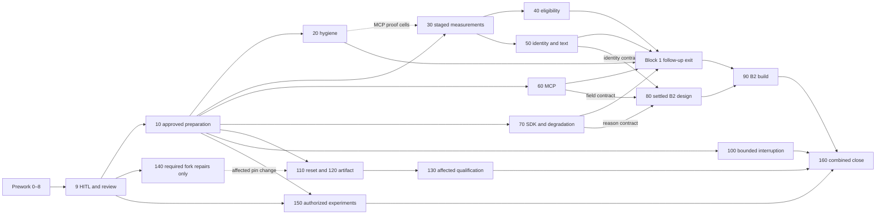

# FathomDB 0.8.29 — release execution plan

## Current execution mandate

November10 owner instruction: use direct per-slice GPT-6.1-high owners, with
Astra-medium adversarial review after scope/plan/design/requirements-AC updates
and again after TDD implementation. Use neither Steward nor Orchestrator roles.
[The direct execution method](0.8.29/direct-execution.md) records the gates,
isolation and retained owner constraints. Approved work advances through that
pipeline; genuinely unresolved scope/policy/venue/spend/publication choices retain
their explicit gates. Earlier proposal-only drafting descriptions below document
the package's origin, not an instruction to stop after drafting.

## Current completion boundary

The owner requests completion of the remaining selected .29 work through direct,
sequential slice agents, excluding CI work/execution and registry publication.
Each slice owner rereads integrated predecessors and revises scope, plan,
requirements/acceptance, design and product architecture where necessary. A fresh
independent Astra-medium adversarial review must pass before implementation;
implementation uses genuine per-behavior RED/GREEN and a fresh Astra-medium final
review. The parent evaluates each result, adjusts release allocation where needed,
integrates accepted work and dispatches the next slice owner. Completed slices
retain their verified exits unless subsequent evidence invalidates affected scope.
No Steward or Orchestrator role is used.

The owner requires `/mnt/data/` for parent and slice worktrees, owned task scratch,
build targets, caches, temporary files and qualification output. Set task-local
`TMPDIR` and `AGENT_LOG_DIR` there; immutable installed tools may be read-only
inputs. Do not relocate or clean another session's resources.

Local lint/typecheck/test, required source-phase verification, source-bound native
consumers and permitted selected hardware qualification remain in scope. CI
workflow changes, remote CI dispatch/monitoring, tag pushes and registry publication
are deferred. Slice160 must distinguish completed local implementation/qualification
from outstanding CI/publication and post-publication consumer proof; this request
does not authorize a published-release completion claim. Specific unresolved
identity, test-policy, artifact, fault-envelope and venue/spend choices retain their
item gates. Resolve those concretely while progressing independent approved work.

## Goal, scope and authority

Finish agent access, improve exact search at scale, and reconcile the paused
MCP/queue/Block 1, Block 2, scale and CUDA work into `dev/0.8.29`.
The owner confirmed 0.8.29 on November 9. This proposal expands the prior
0–120 ladder using the requested prework and mod10 feature slices.

Prework0–9 proposal outputs completed their independent review gates; the
approved preparation now advances in10 through its own plan/TDD/final-review
pipeline. Specific fault/venue, artifact/policy, session/spend, optional study and
publication choices retain their actual item gates. Proposal completion is not
product or environment qualification. No generic final acknowledgment is added.

The [reconciliation register](0.8.29/reconciliation-plan.md) preserves maturity,
TC identities and old branch dispositions. The [planning brief](0.8.29/planning-brief.md)
defines the drafter assignments; [evidence and limits](0.8.29/planning-evidence.md)
identifies actual source/transcript observations. Each slice has its own draft
plan below. Approved scope follows the direct review pipeline; each pending condition remains attached to its owning item.

## Baseline and workspace

- Inspected product-source baseline: `6edc1155f039f87cd0a37660cb27ae4373bbce71`.
  Completed .28 `f4343524198f15cc78ec006ea4e1a4e48cf9f04e` is included.
- Schema baseline: **37**, including transactional read-visibility coalescing.
  Owner ruling, steward `seq-368`: **no database migration is required for .29**.
  Plan against this existing substrate; no migration/data-conversion work or
  release-specific migration campaign is allocated. Older stores remain refused.
  Package-version/release-state metadata changes do not change the database format.
  A design requiring a storage-format change returns for explicit owner scope
  review rather than silently expanding the release.
- MCP/queue/Block 1 are integrated. B2-2/3 hints and part of B2-6 already exist;
  B2-8 storage exists, but its reporting and other residual B2 work remain.
- Canonical branch/worktree: `dev/0.8.29` at
  `/home/coreyt/projects/fathomdb-worktrees/dev-0.8.29`.
  This chat plans in its managed worktree on `llm/0.8.29-chat`; main is untouched.
  Slice 0 proposes ownership/reuse/create/switch procedure; 10 executes only
  approved workspace changes.
- .28 is published and its historical state remains unchanged. Approved10
  metadata bootstrap activates the tracked.29 state/board selected by
  `scripts/release-current.py`; setup and product qualification remain unexecuted.
  Generated control regions below are owned by release-state-0.8.29.json.
- Runtime/manifest versions, available hosts and source-bound verification
  evidence must be distinguished from actual current environment readiness.
  Do not borrow another checkout's venv or repoint editable bindings.

## Prework effort: Slices 0–9

Actual0–9 proposal outputs and independent plan/fresh final reviews are complete
at the Git witnesses recorded in.29 state and each review log. They allocate
future behavior/contract work without claiming product tests or qualification.
Current selection is the reviewed decision log and register, not the seed scores.

| Slice | Scope and durable proposal | Plan |
| ---: | --- | --- |
| 0 | Environment/project infra; release branch/worktree and switching; venv, npm, Rust/Python/TS versions; supported platforms; compute/VM/runner locations and access/resource gaps | [Environment/infra](0.8.29/prework/slice-0/plan.md) |
| 1 | Library/Dependabot sweep method and candidate register; version/source pins and their rationales; upgrade/retain/investigate/postpone dispositions | [Libraries](0.8.29/prework/slice-1/plan.md) |
| 2 | Repo-wide cruft: program/product/dev/contracts/architecture/code/tests/notes and public/developer docs; keep, deprecate-in-place, archive or delete proposals | [Cruft](0.8.29/prework/slice-2/plan.md) |
| 3 | Draft CRUD of needs, requirements, acceptance and architecture; allocate every change to a slice, including new prerequisites | [Contract drafts](0.8.29/prework/slice-3/plan.md) |
| 4 | Review architecture proposals and high-level source alignment; propose code or architecture corrections without implementing them | [Architecture fit](0.8.29/prework/slice-4/plan.md) |
| 5 | Need→requirement→AC→test traceability, product-level adequacy, known critical paths and gaps; distinguish declared tests from meaningful oracles | [Verification adequacy](0.8.29/prework/slice-5/plan.md) |
| 6 | Source/transcript evidence of stale user, library-consumer/developer and contributor docs; proposed correction/ownership | [Documentation](0.8.29/prework/slice-6/plan.md) |
| 7 | Build/preflight/agent-verify/CI/packaging/gitleaks/runner/registry delays after product success; bounded pragmatic fixes and evidence reuse | [Delivery](0.8.29/prework/slice-7/plan.md) |
| 8 | Placeholder; remains empty until an explicit placement decision | [Reserved](0.8.29/prework/slice-8/plan.md) |
| 9 | Consolidate 0–8; score understood/risk/effort/include-or-postpone; interactive HITL, decision-bound Slice 10, independent review and at most four FIX-n cycles, final HITL and plan update | [Review/decisions](0.8.29/prework/slice-9/plan.md) |

Slices 0–2 can research independently. Slice 3 uses their inventories; 4 reviews
the draft architecture and 5 traces draft requirements against actual tests.
6/7 may proceed alongside those reviews, feeding corrections back into 3–5.
These are drafting dependencies, not permission for concurrent edits to shared
canonical documents. Slice 9 waits for each output or an explicit unavailable/
reserved disposition, and records remaining uncertainties without pretending
they were resolved.

### Slice 9 scoring and HITL protocol

Use [the initial proposal register](0.8.29/proposal-register.md) as a seed, then
update it from actual prework. Score each item on:

- Understood: high, medium or low, with missing evidence.
- Risk: low, medium or high, naming correctness, compatibility or delivery risk.
- Effort: S (bounded edit/verification), M (several seams), L (new design or
  external qualification); these are comparative sizes, not time promises.
- Recommendation: include, conditional include, postpone or close as already
  satisfied. Record a rationale, slice and dependencies for each.
- HITL: pending/approved/rejected/deferred, exact decision and conditions.

Present small coherent decision batches interactively. Capture the user's
actual decisions in the local decision log; use ledgerwrite for any resulting
canonical ledger events, with stable TC identities and a fresh full-tail read.
Do not preselect approval or infer it from time or silence.

Slice9 now supplies the reviewed decision-to-task mapping.10 refines that scope,
obtains independent Astra-medium plan PASS, implements with observed RED→GREEN
and receives fresh independent implementation review. New material policy, venue,
spend or publication choices return to the owner as concrete item decisions;
approved preparation does not need another generic acceptance. State activation
preserves real proposal closures and leaves10 open until verified integration.

## Slice ladder — preparation and features

### Reserved-gap policy

Feature numbering begins at **20** in multiples of ten. Slice 10 is preparation
authorized by Slice 9, not the first feature. Empty gaps are not patch lanes;
new initial features receive mod10 numbers and explicit placement.

### Preparation and feature allocations

| Slice | Scope | Hard inputs or conditions | Draft plan |
| ---: | --- | --- | --- |
| 10 | Approved workspace/environment/tool/dependency/doc/CI preparation; coordinated version decisions; state/board/views and selected rerunnable tools | Actual reviewed9 decisions and independent10 plan PASS; own implementation/final gate | [Preparation](0.8.29/features/slice-10/plan.md) |
| 20 | Residual test hygiene, queue enqueue/drain race, warning/parallel failures and chunking tripwire constant test | Needed 10 preparation; current residuals verified rather than assumed | [Test/queue hygiene](0.8.29/features/slice-20/plan.md) |
| 30 | Current 100k tracked AC-083 and baseline, write-interleaved/cache suitability, MCP/SDK/open/embedding, drain/300k follow-ups | Closed10 plus qualified Linux20/current70 for reviewed P only; G/D extension review, M20 proof and F frozen-input holds remain | [Measurement](0.8.29/features/slice-30/plan.md) |
| 40 | Remaining eligibility cache and selected per-batch metadata work | 30 evidence; reviewed format37 snapshot/invalidation design; no automatic counter/schema fallback | [Eligibility/batch](0.8.29/features/slice-40/plan.md) |
| 50 | Fusion identity ADR/census, exact deferred-content text route and Unicode-safe record-start snippets | 30 baseline; accepted identity semantics before optimized production route | [Fusion/text](0.8.29/features/slice-50/plan.md) |
| 60 | MCP compact text default and structured mode, flags, filtered direct text search, budgets/paging/errors | Existing .28 filter/flag support and reconciled accepted surface design; final parity on integrated fusion | [MCP surface](0.8.29/features/slice-60/plan.md) |
| 70 | Remaining degradation labels, facade/SDK/native parity and UTF-8 contracts | Current failed-open contract and reviewed bounded reason scope | [Degradation/SDK](0.8.29/features/slice-70/plan.md) |
| 80 | Unified residual Block 2 requirements/design, built-signal inventory, truthful coverage/scored spans | Built hints/queue/span storage; settle compact, identity and degradation field contracts before approval | [Block 2 design](0.8.29/features/slice-80/plan.md) |
| 90 | Implement only accepted B2 residuals; preserve existing signals | Approved 80 AND Block 1 follow-up exit below | [Block 2 build](0.8.29/features/slice-90/plan.md) |
| 100 | Reconcile and complete bounded interruption/reopen qualification of current erasure transaction/checkpoint seams | Current format37 cleanup/maintenance contract; existing coverage comparison | [Interruption](0.8.29/features/slice-100/plan.md) |
| 110 | CUDA context-reset lifetime/teardown remedy and bounded fault qualification | Reviewed reset design, permitted GPU venue; qualified fork fix if needed | [Reset safety](0.8.29/features/slice-110/plan.md) |
| 120 | Required CUDA usage/policy review; second CUDA13 artifact design and delivery | Accepted policy/ratified changes, final chosen affected pins, explicit distribution/driver/library/PTX contracts | [CUDA artifact](0.8.29/features/slice-120/plan.md) |
| 130 | Selected CUDA platform, SDK pool-release and revised soak qualification; non-Tegra initialization study | Approved venues, artifact/pins under test, test-only observations and reviewed hypotheses | [CUDA qualification](0.8.29/features/slice-130/plan.md) |
| 140 | Required fork repairs only (A); versioning only when needed to release those repairs | Concrete approved110/120 repair need; fork-local qualification before pins; B/C maintenance moves to .30 under steward seq-367 | [Required fork repairs](0.8.29/features/slice-140/plan.md) |
| 150 | Conditional candidate selection, coalescing and SDK hints experiments | Explicit 9 experiment decisions, preregistration and current native-eligibility baseline; separate product promotion approval | [Experiments](0.8.29/features/slice-150/plan.md) |
| 160 | Combined qualification, release notes/docs and publication readiness | All selected work complete/qualified or explicitly disposed; unresolved mandatory items block close | [Close](0.8.29/features/slice-160/plan.md) |

### Allocation changes from the previous plan

20–110 retain their subject allocation. The former 120 CLOSE becomes **160**.
New 120–140 explicitly place CUDA/fork carryovers previously absent from the
ladder; 150 places checkpoint-authorized experiments. These are proposed
placements, not claims that every candidate must ship or has design approval.
The old reconciliation review did not approve this expanded ladder.

B2-8 and compact text-default decisions are already accepted; do not ask again.
Built B2-2/3 and partial B2-6 need preservation/current qualification, not duplicate
implementation. The broader EP-03 draft, new weak-result thresholds, overflow
chunking, ANN and caller-provider production APIs are not implied by allocation.

## Draft release needs, requirements and acceptance allocation

These release-local mappings retain canonical product needs and locked ACs.
Completed3–5 provide reviewed CRUD/source/oracle allocation; each behavior owner
implements its accepted contract changes in the same reviewed scope.

| Draft need / requirement | Acceptance signal | Allocation |
| --- | --- | --- |
| N29-A / R29-REL-A: agents receive usable, bounded, truthful results | Real MCP queue/lifecycle/filter/flags/budget/paging tests under both formats; existing and residual B2 behavior distinguished |20,60,80,90 |
| N29-S / R29-REL-S: exact retrieval holds up at scale | Approved identity/reference equivalence, real write-interleaved validity controls, unchanged accepted gates and reported tracked AC083 |30,40,50 |
| N29-K / R29-REL-K: SDKs expose the accepted contract consistently | Rust/Python/TS behavior and typed error/byte-span parity on source-bound native artifacts |50,70,90 |
| N29-R / R29-REL-R: faults preserve truthful outcomes and safe cleanup | Existing-coverage comparison plus real transaction/checkpoint/reopen and permitted reset/close/drop controls within declared fault models |100,110 |
| N29-G / R29-REL-G: selected GPU artifacts match actual support | Ratified policy, qualified selected pins/platforms, driver/library/PTX and installed-consumer evidence; unknown cells remain unclaimed |120,130,140 |
| N29-D / R29-REL-D: deliver the selected release without repeated solved failures | Decision-to-preparation coverage, owned tools, bounded CI/package/auth prerequisites, assembled-source qualification and conditional post-publication registry smoke |0–10,160 |

## Dependency graph and safe parallelism

The unnumbered **Block 1 follow-up exit** requires integrated selected work in
20–70, applicable full/feature/performance checks, MCP conformance in both
formats and approved smoke/item-4 remeasure. It precedes 90 and is not 160,
avoiding a 90↔close dependency cycle. Resolve inherited conformance failures
against supported capabilities; no silent baseline waiver.

The reviewed [Slice30 prerequisite amendment](0.8.29/features/slice-30/prerequisite-change.md)
permits initial provider-free Linux direct-text P work from closed10 and the
qualified integrated Linux20/current70 baseline. Parent-owned state records10
as30's entry dependency; actual ancestry, strict owned preflight and explicit
source GO remain required. This advances eligible P work while20 is open; it
neither closes20 nor clears whole30/40/50/Block1. G/D need concrete extension
review, M retains20 proof/policy and F retains exact frozen TC5 inputs. Only
unfiltered P1 supplies the tracked100k text result; marker/write-filter P2 is
separate. Numerical order is not an execution prerequisite.

40 before 50 is preferred landing order for attribution/shared engine files, not
a semantic requirement. 60 can develop independently of their implementation;
its final parity control runs on the same fused build. 80 design can start early,
but approval/build use settled contracts. Engine landings 40/50/70/100/110 are
serialized, as are shared state/ledger/manifest/interface writes.

Owner ruling, steward `seq-367`: .29 focuses on A, required fork repairs only.
The [Candle rebase, marker cleanup and multiarchitecture work](0.8.30/fork-maintenance-plan.md)
belong to .30 and are not .29 prerequisites. If a required repair needs that
broader work, return to the owner rather than silently widening140.

140's included required repairs have their own qualification before pin adoption.
Then 110/120 integrate chosen pins, and 130 performs affected final qualification.
130's final campaign is not a prerequisite for 140's initial fork work. A reset
design may discover a fork prerequisite without requiring completed 110 first.

Edges into 80 denote settled contracts, not completion of the source feature
implementation. The graph shows selected work; a conditionally excluded item reaches close through
an explicit disposition, not a fabricated passing run. Numerical order is not a
dependency rule. Independent research/drafting may run concurrently. Concurrent
repository writers use separate worktrees; root-owned planning drafts are
imported serially. Never share checkout branch switching or another writer's venv.

## Cross-cutting DoD — contract, design and verification discipline

Every slice begins with prep: confirm goals/current maturity; write local draft
needs, requirements, acceptance and architecture CRUD; read active architecture;
draft design; identify challenges and primary-source research approaches; check
fit/revise; record prerequisites for the next reviewer. Allocation is not design
approval. Interface/public API changes need the accepted ADR/interface updates
when implementation is authorized.

Each implementation slice then reviews requirements/design, uses per-behavior
failing tests and RED→GREEN, gets independent code review and appropriate native/
SDK parity, updates maintained docs, and lands a bounded reviewed branch.
Metadata-only changes use scoped validators; final code phases run required full
verification once, with affected reruns after corrections. Missing owned setup
is a preflight failure. Preserve failed/assembled campaigns accurately.

Tests use real databases and independently specified invariants: cache versus
reference snapshot results, fusion identity/provenance, UTF-8 boundaries,
filter-before-cap selection, paging/budget correctness, queue shutdown and fault/
reopen post-state. Property tests cover round trips and boundary behavior.
Process kill is not machine/power-loss proof; reset detection is not safe teardown.

AC-083 is owner-authorized, tracked rather than gated: 100k LongMemEval text,
p50<=80ms and p99<=300ms target. Add its canonical entry only in authorized
implementation, not by editing locked dev/acceptance.md during prework.
No new numerical release gates are created by these proposals.

## Quality and CUDA planning reviews

The [quality roadmap](../notes/fathomdb-quality-testing-roadmap.md) applies to
owned fault/reopen seams, resource release, boundary/property tests and
optimized/reference comparisons. Keep general SQLite fuzzing, broad protocol
fuzz programs and exhaustive platform/scale/CUDA matrices at their existing
later checkpoints. New evidence: format37 invalidation, final provider/cleanup
changes and partial B2 implementation invalidate several old assumptions.

The [CUDA review procedure](../design/cuda-version-support-review.md) is required.
The [November10 CUDA review](0.8.29/research/cuda-version-adoption.md) refreshed
primary package/vendor signals and recorded failed comparable-window collection;
fresh adoption shares remain unknown. Accepted importance ratings stay unchanged.
New compiler evidence adds a proposed Slice120 delivery gate: assess exact kernel/
toolchain exposure and mitigation before a13.0-built artifact. FathomDB exposure
is unproven; toolkit/artifact/policy changes still require owner ratification.
Keep the accepted [support policy](../adr/ADR-0.8.28-cuda-version-support-policy.md)
until an amendment is ratified: 12.6 shipping floor,13.0 next artifact, R580 host
constraint; no K620 execution or implicit Jetson reflash. CUDA13 library
qualification is not a completed product artifact or Q5 Tegra qualification.

## Prework execution context

Owner authorized starting work in this chat on November 10. The archived planning
checkout was recovered into this chat's attached replacement at
`/home/coreyt/.codex/worktrees/fathomdb-0829-work/dev-0.8.29`, preserving
`llm/0.8.29-chat` and baseline. [Current prework findings](0.8.29/prework-status.md)
record actual bounded research, unavailable evidence and checkpoint intake.
These outputs do not activate .29 or approve environment/product changes.

## Integration, decisions and next action

Selected work integrates through the local `release/0.8.29` ref from
`llm/0.8.29-chat` in /mnt/data/worktrees/fathomdb-0.8.29, preserving integrated
.28 and MCP/Block1 contracts. Preserve experiment sources and selectively adapt tools;
no wholesale old prototype merge. Before landing, fetch allowed refs, check
ancestry/current branch and integrate/review changed boundaries before a
fast-forward. Never force-push or move another session's checkout.
The .28-only first-tag CUDA exception does not authorize .29 routing; resolve
that bounded prerequisite through 7/9/10 before160 without weakening protections.
Use JSON as the single writer of generated release views after activation.
Use ledgerwatch/ledgerwrite for ledgers and stable TC ids.

[The proposal register and decision log](0.8.29/proposal-register.md) distinguish
approved work from genuinely pending item decisions. Actual0–9 reviews are
complete. Approved10 preparation and qualified product subsets are recorded in
the live state; [30 P results](0.8.29/features/slice-30/results-p.md) now provide
current direct-text evidence. P acceptance does not close whole30 or downstream
source gates. The same30 owner next prepares a concrete G/D extension design
for independent Astra review before parent source/runtime GO. Product work
continues through the selected ladder, actual prerequisites and genuine TDD.
Publication remains separately authorized.

## Immediate next slice

<!-- BEGIN GENERATED release-state:0.8.29:plan-immediate-next -->
**IMMEDIATE NEXT: Slice 30** (`MEASURE`) — Current source-bound baseline and tracked AC083 measurements

**Remaining ladder:** 30 → 20 → 40 → 50 → 60 → 80 → 90 → 100 → 110 → 120 → 130 → 140 → 150 → 160.<!-- END GENERATED release-state:0.8.29:plan-immediate-next -->
